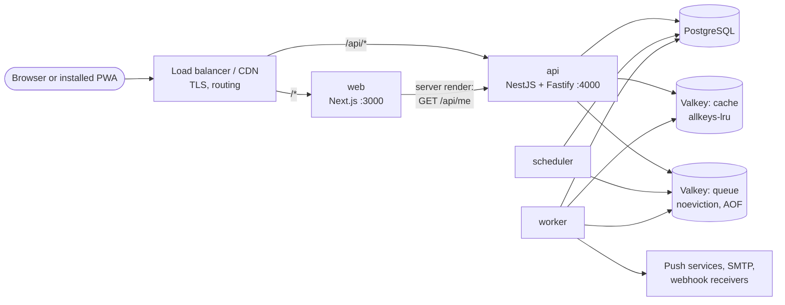
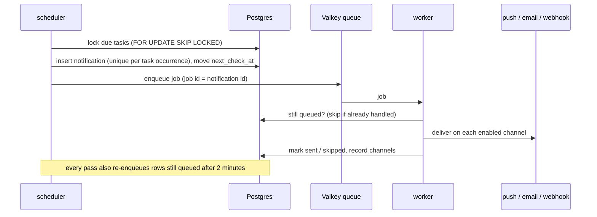

# Rhythm: architecture and runtime contract

This is the handover from the developers to whoever runs Rhythm in
production. It says what each process needs, how it behaves when things go
wrong, and what is likely to break first under load. The code is done.
Packaging, infrastructure and operations are not, and that's the job.

## The pieces

Four long-running processes, all stateless, all safe to run as several
copies. State lives in Postgres (the record), a Valkey cache (disposable) and
a Valkey queue (must not lose jobs).

| Process | Command | Listens on | Health | Scale |
|---|---|---|---|---|
| web | `node .next/standalone/server.js` | `PORT` (3000) | `GET /healthz` | horizontally |
| api | `node dist/api/main.js` | `PORT` (4000), metrics 9464 | `GET /healthz`, `GET /readyz` | horizontally |
| worker | `node dist/worker/main.js` | metrics 9465 | `GET /healthz` on metrics port | horizontally, `WORKER_CONCURRENCY` jobs each |
| scheduler | `node dist/scheduler/main.js` | metrics 9466 | `GET /healthz` on metrics port | 2 for availability; more adds nothing |
| migrate | `node dist/scripts/migrate.js` | | exits 0 when done | one run per deploy, before new code |
| seed | `node dist/scripts/seed.js` | | exits 0 when done | catalogue upsert, safe on every deploy |

All backend processes come from one build of `backend/` (one image, different
commands). The web app is its own build.

## How a request travels

**Pages.** The browser asks for `/today`. The web server renders the page; to
know who you are it calls `GET /api/me` on the API over the private network
(`API_INTERNAL_URL`), forwarding your cookie and an `x-request-id`. No
session cookie, or a 401, redirects to `/login`.

**API calls.** After the page loads, the browser calls `/api/*` on the same
origin, so the httpOnly session cookie travels with it and no CORS is needed.
In production the load balancer should route `/api/*` straight to the API.
The web server also has a rewrite that proxies `/api/*`; it exists for local
development and is fixed at build time (see risks).

**Live updates.** `GET /api/events` is a server-sent events stream. Each API
process holds one Valkey pattern subscription and fans events out to its own
open streams. Events: `task.changed`, `group.changed`, `notification`, plus
a `ping` every 25 seconds so idle proxies keep the stream open. Browsers reconnect by
themselves when a stream drops, including when its API process shuts down.
WebSockets aren't used: every live update flows from server to browser, and
SSE does that over plain HTTP.

## Configuration and secrets

All configuration is environment variables, validated at start-up; a bad
value stops the process with a message naming it. `backend/.env.example`
documents every variable. In production `NODE_ENV=production`, no `.env`
file is read, and `DATABASE_URL`, `CACHE_URL`, `QUEUE_URL` and `APP_URL` are
required.

Secrets to keep in a secret store:

| Secret | Notes |
|---|---|
| `DATABASE_URL` | contains the database password |
| `SMTP_URL` | contains SMTP credentials |
| `VAPID_PRIVATE_KEY` | must stay the same across deploys: a new key pair invalidates every phone's push subscription |
| `CACHE_URL`, `QUEUE_URL` | if your Valkey uses a password or TLS (`rediss://`) |

Webhook signing secrets are generated per webhook and stored in Postgres.

Settings that must match the environment:

- `COOKIE_SECURE=true` anywhere with HTTPS.
- `TRUST_PROXY`: the number of proxies in front of the API. See risks.
- `APP_URL`: the public URL, used in emails and webhook payloads.
- `API_INTERNAL_URL` (web): needed at build time and at run time.

## Health, metrics and logs

**Liveness and readiness.** `/healthz` answers 200 while the process can
serve; restart it if that stops. `/readyz` checks the database and returns 503
when Postgres is unreachable or the process is shutting down; stop sending
traffic when it fails. The cache is reported in `/readyz` but doesn't fail it,
because the API works without it, only slower. The web app's `/healthz`
deliberately doesn't call the API: restarting the web server can't fix the API.

**Metrics.** Every backend process serves Prometheus metrics on its own port,
never on the public port. Besides Node's defaults (CPU, memory, event loop lag,
GC):

| Metric | Process | Watch for |
|---|---|---|
| `http_request_duration_seconds{method,route,status_code}` | api | p95/p99 latency, 5xx rate. Routes are templates (`/api/tasks/:id`), so cardinality stays low |
| `cache_requests_total{result}` | api | hit ratio; `error` means Valkey is down and Postgres takes the load |
| `auth_attempts_total{action,result}` | api | spikes in failures (credential stuffing) |
| `sse_connections` | api | open streams per process; uneven spread after deploys |
| `scheduler_tick_duration_seconds` | scheduler | ticks approaching `SCHEDULER_INTERVAL_MS` |
| `scheduler_tasks_checked_total{outcome}` | scheduler | reminders created vs skipped as too late |
| `notifications_created_total{kind}` | scheduler, api | reminder volume |
| `queue_jobs{state}` | worker | `waiting` growing means add workers. Every worker reports the same queue, so aggregate with `max`, not `sum` |
| `notification_deliveries_total{channel,result}` | worker | failure rate per channel; `expired` push subscriptions are normal |
| `notification_job_duration_seconds{result}` | worker | slow push services or SMTP |

**Logs.** JSON lines on stdout (pino), one per request with method, route,
status and duration, plus `requestId`. The API accepts an incoming
`x-request-id` or makes one, returns it in the response, and the web server
forwards it on server-side calls, so one ID follows a page render into the
API. Passwords, cookies and authorization headers are redacted.

## Deploys and shutdown

**Migrations.** Plain SQL files in `backend/migrations`, applied in name order,
each in a transaction, recorded in `schema_migrations`. Run
`node dist/scripts/migrate.js` once per deploy, before new code starts (a
Kubernetes Job, an ECS one-off task, a pipeline step). A Postgres advisory lock
makes concurrent runs safe: one applies, the others wait and find nothing to
do. During a rolling deploy old and new code run side by side, so a
migration must work with both: add a column, deploy, backfill, then remove
the old one in a later release.

**Shutdown.** On SIGTERM the API:

1. fails `/readyz` with 503, so the load balancer stops sending new requests;
2. keeps serving for `SHUTDOWN_DELAY_MS` (default 5 s in production) while
   that change reaches the load balancer;
3. closes SSE streams (browsers reconnect to another process);
4. stops accepting connections, finishes in-flight requests;
5. closes database, cache and queue connections and exits.

Give it time to do this: the platform's grace period (Kubernetes
`terminationGracePeriodSeconds`, ECS `stopTimeout`) must exceed the delay plus
your slowest request. The worker finishes its running jobs before exiting;
the scheduler finishes its current pass.

Run `node` as the container's main process. `npm start` and some shells don't
pass SIGTERM on, and the process is then killed mid-request.

## Reliability patterns

### Reminders: outbox, queue, idempotent delivery

- Several schedulers can run: `SKIP LOCKED` hands each due task to exactly
  one of them.
- The notification row is written in the same transaction that moves the
  task's next check, so a reminder is never lost or created twice. A unique
  index on the occurrence makes duplicates impossible even across retries.
- Enqueueing happens after the commit. If the process dies in between, the row
  stays `queued`, and every scheduler pass re-enqueues rows queued for more
  than two minutes. Job ids are notification ids, so re-enqueueing a job that
  exists does nothing.
- Delivery is at least once: a job can run twice (a worker crash after
  sending). The worker checks the row's status first and the push carries the
  notification id as its tag, so a repeat replaces rather than duplicates.
- Failures retry 5 times with exponential backoff from 10 seconds. If one
  channel works and another fails, the notification counts as sent and isn't
  retried, so nobody gets the same push twice.
- Reminders more than `NOTIFY_MAX_LATENESS_MINUTES` late (default 180) are
  skipped: after an outage, nobody gets a burst of stale "brush your teeth".

### Sessions and caching

A session is a random token in an httpOnly, SameSite=Lax cookie; Postgres
stores only its SHA-256 hash. Lookups are cached in Valkey for 5 minutes and
invalidated on sign-out and profile changes. Catalogue food searches are
cached for 10 minutes. Every cache read falls back to Postgres if Valkey fails, so a
cache outage costs latency, not availability. Expired sessions are deleted by
the scheduler.

### Rate limits

Counters live in Valkey, keyed by user when signed in and by client IP when
not: `RATE_LIMIT_MAX` requests a minute (300), and `RATE_LIMIT_AUTH_MAX`
sign-in and sign-up attempts a minute per IP (10). If Valkey is down, limits
fail open rather than blocking everyone.

### Webhooks

Each delivery is a POST with a JSON body that also works as a Slack or
Discord message, an `X-Rhythm-Signature: sha256=<hex>` HMAC of the body, and
an `X-Rhythm-Delivery` id. A 5-second timeout, no redirects, and a check that
the URL doesn't resolve to a private, loopback or link-local address (cloud
metadata at 169.254.169.254 included). That check runs when the webhook is
saved and again at every delivery, in case DNS changes. Three webhooks per
account.

## Data

Postgres holds everything that matters: users, sessions, groups and members,
tasks and completions, workouts and sets, foods and food entries,
notifications, push subscriptions, webhooks. No extensions are required.

Tables that grow without limit and will need a retention job: `notifications`
(one row per reminder), `task_completions`, `food_entries`, `workout_sets`.
Only expired sessions are cleaned up today.

Back up Postgres (point-in-time recovery). The queue's AOF only protects jobs
in flight; losing it entirely costs at most the reminders in it, and the
sweep re-enqueues anything still marked `queued`. The cache needs no backup.

## What will break first

Ordered roughly by how soon a global load test will find it.

1. **Sign-in is CPU-bound by design.** argon2 hashing takes tens of
   milliseconds of CPU and about 19 MiB of memory per attempt. A test that
   signs in for every virtual user saturates API CPU long before anything
   else. Size CPU for the sign-in rate you expect, and have load tests reuse
   sessions as real users do.
2. **`TRUST_PROXY` decides who gets rate limited.** Behind a load balancer,
   with `TRUST_PROXY=false`, every request seems to come from the load
   balancer, so all signed-out users share one bucket of 10 sign-ins a minute.
   Set too high, clients can fake `X-Forwarded-For` and dodge limits. Set it
   to the real number of hops. If `/api/*` goes through the web server's
   rewrite, that's one more hop.
3. **Database connections run out.** Each process opens up to `DB_POOL_MAX`
   (10). Ten API pods, four workers and two schedulers is already 160,
   above Postgres's default of 100. Add PgBouncer in transaction mode and set
   `DB_PREPARE=false` (prepared statements don't survive transaction pooling).
   Run migrations against Postgres directly, not through PgBouncer: the
   migration lock is a session-level advisory lock.
4. **Food search scans the table.** `ILIKE '%term%'` can't use a normal
   index. Fine for the catalogue; slow once users add thousands of foods. Add
   `pg_trgm` and a GIN trigram index on `foods.name` in a new migration.
5. **One Valkey for both cache and queue loses jobs.** The cache evicts keys
   when full (`allkeys-lru`); BullMQ needs `noeviction` or it silently loses
   jobs. Keep them separate, as `compose.yaml` does.
6. **SSE behind proxies.** Long-lived responses meet idle timeouts (the
   25-second heartbeat keeps most of them open), buffering (the API sends
   `X-Accel-Buffering: no` for nginx; check others) and compression that
   holds events back. Browsers allow only six HTTP/1.1 connections per site,
   so serve HTTP/2 at the edge. Long streams also skew least-connections
   balancing, and every API process receives every user's events, which is
   fine up to tens of processes.
7. **The web build bakes in some configuration.** The `/api/*` rewrite's
   destination is written into `.next/routes-manifest.json` by `next build`.
   Tested: built with `API_INTERNAL_URL=http://localhost:4000`, then started
   with `http://localhost:4999`, the rewrite still went to 4000, while
   server-side calls used 4999. Build with the right value or, better, route
   `/api/*` at the load balancer. The same applies to any `NEXT_PUBLIC_*`
   variable (none are used yet).
8. **Rolling deploys of the web app.** Each build has different JavaScript
   chunk names. A browser holding a page from the old version asks for old
   chunks; if the new pods don't have them, navigation breaks until reload.
   Serve `.next/static` from a CDN or bucket that keeps previous versions, or
   look at Next.js's `deploymentId` setting.
9. **The worker needs outbound internet.** Push goes to Google's, Apple's and
   Mozilla's push services, email to your SMTP provider, webhooks anywhere. In
   a private subnet that means a NAT gateway; consider an egress proxy for
   webhooks.
10. **Push needs HTTPS and stable keys.** Browsers allow push only on secure
    origins (and localhost). On iPhone it works from iOS 16.4, after the app
    is added to the home screen. Rotating VAPID keys silently ends every
    existing subscription.
11. **Time.** Deadlines are computed in each group's time zone, so server
    clocks must be NTP-synced; the container's own time zone doesn't matter.

## Not included, on purpose

Dockerfiles, Kubernetes or ECS definitions, Terraform, CI/CD pipelines, TLS
certificates, a CDN, backups, dashboards, alert rules and load tests. The
README suggests an order to build them in.
